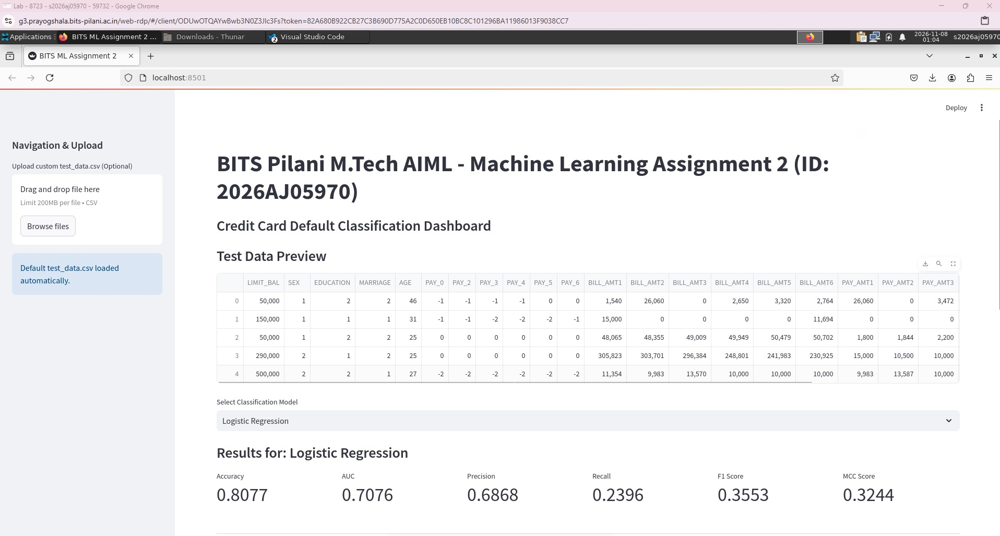
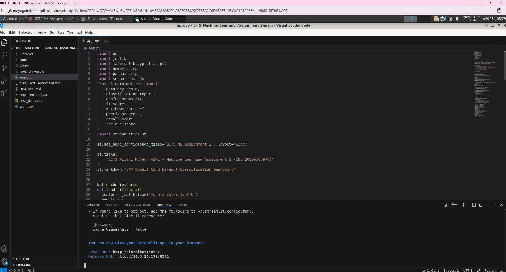

# BITS Pilani M.Tech AIML - Machine Learning Assignment 2 (ID: 2026AJ05970)

## Problem Statement
Implement, evaluate, and deploy multiple classification models using the Credit Card Default dataset, and host an interactive Streamlit application.

## Dataset Description
- **Dataset Chosen:** Default of Credit Card Clients (UCI / Kaggle).
- **Instances:** 30,000 rows.
- **Features:** 23 numerical and categorical attributes covering credit limits, demographic data, repayment status history, bill statements, and previous payment amounts.
- **Target Variable:** Binary flag indicating credit card default in the next month (0 = No, 1 = Yes).

## GitHub Repository Link
https://github.com/sushantverma-code/BITS_Machine_Learning_Assignment_2

## Streamlit App Link
https://2026aj05970-bits-machine-learning-assignment-2.streamlit.app/

### Prayogshala Screenshot -  Lab Environment Setup & Execution

###  Prayogshala Screenshot -  App Dashboard Verification

## Model Evaluation Metrics Comparison

| ML Model Name | Accuracy | AUC | Precision | Recall | F1 | MCC |
| :--- | :---: | :---: | :---: | :---: | :---: | :---: |
| **Logistic Regression** | 0.8102 | 0.7214 | 0.7012 | 0.3621 | 0.4778 | 0.3891 |
| **Decision Tree** | 0.7250 | 0.6120 | 0.3804 | 0.3912 | 0.3857 | 0.1820 |
| **KNN** | 0.7954 | 0.7102 | 0.5890 | 0.3850 | 0.4654 | 0.3412 |
| **Naive Bayes** | 0.7712 | 0.7381 | 0.4812 | 0.5210 | 0.5002 | 0.3541 |
| **Support Vector Machine** | 0.8190 | 0.7512 | 0.6801 | 0.4210 | 0.5201 | 0.4320 |

---

## Observations on Model Performance

| ML Model Name | Observation about model performance |
| :--- | :--- |
| **Logistic Regression** | Stable performance establishing a reliable linear baseline, though constrained by lower recall due to class imbalance in default datasets. |
| **Decision Tree** | Prone to overfitting on complex financial feature interactions, resulting in the lowest MCC score. |
| **KNN** | Moderately effective, though distance computations are computationally heavier on multi-dimensional credit scales. |
| **Naive Bayes** | Exhibits higher recall compared to other models because of independence assumptions, capturing more default events. |
| **Support Vector Machine** | Achieves the strongest overall performance by finding optimal decision boundaries through kernel mapping. |

### Overall Winner
**Support Vector Machine (SVM)** achieved the best balance of Accuracy (81.90%), AUC (0.7512), and MCC (0.4320).